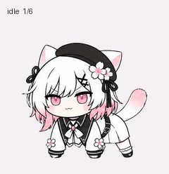

# Sakuraba Ema

白发粉色发梢、黑色贝雷帽与樱花装饰的动画宠物。包含 **9 组动画和 16 个视线方向**。

An animated cat companion with white-and-pink hair, a black beret and cherry blossoms. Includes **9 animation states and 16 look directions**.

## 下载 / Downloads

- [透明精灵表 / Transparent sprite sheet](spritesheet.png)
- [动画预览 / MP4 preview](previews/all-states.mp4)
- [帧布局 / Frame layout](pet.json)
- [完整帧预览 / Contact sheet](previews/contact-sheet.png)

仓库 Release 的 ZIP 包收录精灵表、预览和布局说明。

## 格式 / Format

| Item | Value |
| --- | --- |
| Sprite version | v2 |
| Image | 1536 × 2288 PNG, RGBA |
| Grid | 8 columns × 11 rows |
| Cell | 192 × 208 px |
| Used frames | 73 |
| Unused cells | 15, fully transparent |

Rows 0–8: idle, running-right, running-left, waving, jumping, failed, waiting, running (focused work), review.

Rows 9–10: sixteen clockwise look directions in 22.5° steps. 0° points up, 90° right, 180° down and 270° left.

边缘在高清源图中完成去底色后再缩小，以保留连续轮廓和抗锯齿透明边缘。精灵表已通过结构、透明背景、动作和方向校验。

Blue-screen removal is performed before downsampling the high-resolution source frames. The final sprite sheet passed structural, transparency, animation and direction checks.
